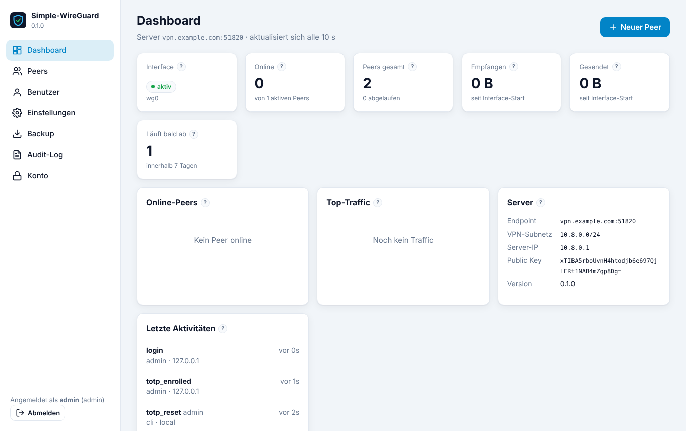
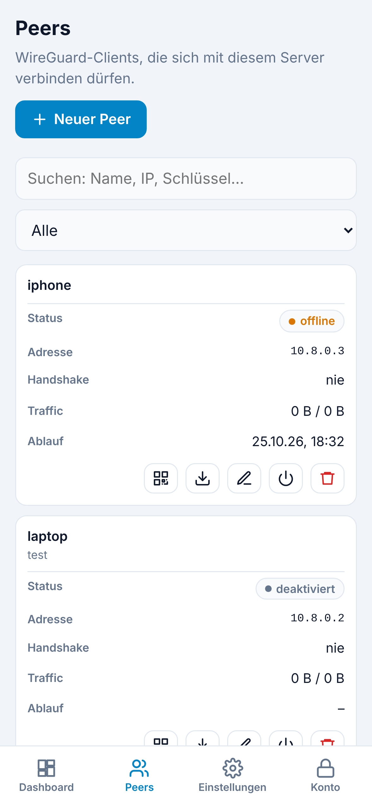
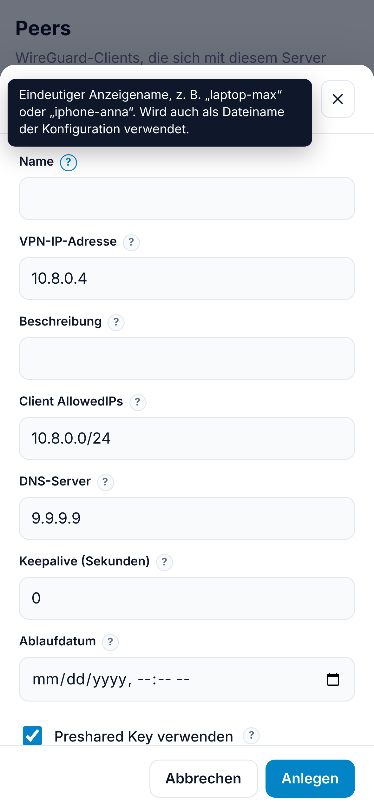
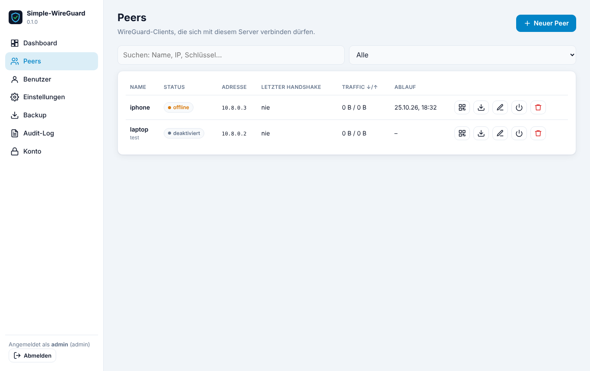
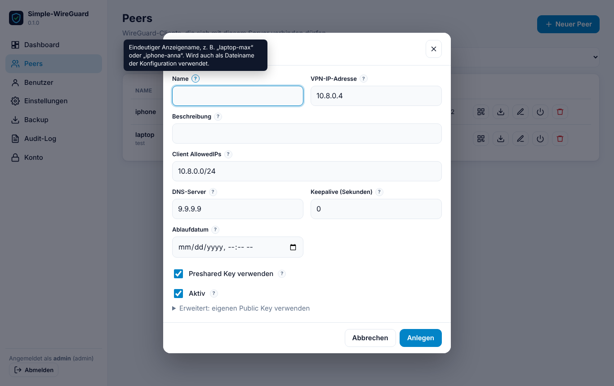
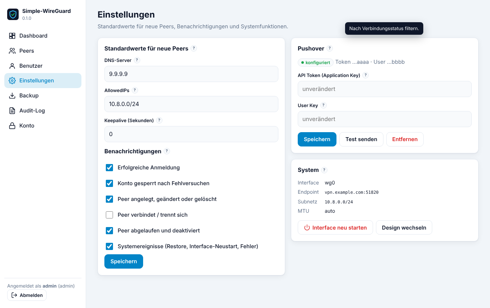

# Simple-WireGuard

WireGuard-Server für Ubuntu mit einer Weboberfläche zum Verwalten von Peers. Dazu kommen Dashboard, Benutzerverwaltung mit Pflicht-TOTP, Pushover-Benachrichtigungen, verschlüsselte Backups und Audit-Log. Die Oberfläche lässt sich als PWA installieren und ist für Smartphones optimiert.



<table>
<tr>
<td width="33%"></td>
<td width="33%"></td>
<td>

**Mobil (iPhone 15 Pro):** Die Tabellen werden zu Karten, unten gibt es eine Navigationsleiste, Dialoge öffnen als Bottom-Sheet. Tooltips erscheinen per Tap auf <kbd>?</kbd>. Über „Zum Home-Bildschirm“ lässt sich die Seite als PWA installieren.

</td>
</tr>
</table>

<details>
<summary>Weitere Screenshots (Desktop)</summary>

| Peers | Peer anlegen (Tooltip per Hover) |
|---|---|
|  |  |



</details>

## Installation

```bash
git clone https://github.com/chevchelios420x/Simple-Wireguard.git
cd Simple-Wireguard
sudo bash install.sh                       # DRY-RUN: prüft alles, zeigt den Plan, ändert NICHTS
sudo bash install.sh --force               # Plan wirklich ausführen
sudo bash install.sh --endpoint vpn.example.com --port 51820 --subnet 10.8.0.0/24 --force
```

**Standardmäßig läuft der Installer immer als Dry-Run.** Er führt alle Prüfungen durch und zeigt den vollständigen Plan: Pakete, Dateien, Schlüssel, Zertifikat, Interface, Ports und Dienste. Er installiert dabei kein Paket, schreibt keine Datei und legt auch kein Log an. Rückfragen werden im Dry-Run nur angezeigt. Erst mit `--force` wird der Plan nach einer letzten Bestätigung ausgeführt. Am Ende des Dry-Runs steht der passende Befehl zum Kopieren.

Am Ende zeigt das Script die URL (Standard `https://<server>:4444`), den SHA256-Fingerprint des Zertifikats und **einmalig** das initiale Admin-Passwort. Beim ersten Login werden ein Passwortwechsel und die TOTP-Einrichtung erzwungen.

| Option | Standard | Bedeutung |
|---|---|---|
| `--endpoint` | öffentliche IP | Hostname/IP, die Clients verwenden |
| `--port` | `51820` | WireGuard UDP-Port |
| `--subnet` | `10.8.0.0/24` | VPN-Subnetz (privat, IPv4) |
| `--dns` | `1.1.1.1, 9.9.9.9` | DNS für Clients |
| `--iface` | `wg0` | Interface-Name |
| `--gui-port` | `4444`, sonst Fallback `9443`, sonst Abfrage | HTTPS-Port der Oberfläche |
| `--cert/--key` | Self-Signed | eigenes TLS-Zertifikat |
| `--renew-cert` | – | Self-Signed-Zertifikat neu erzeugen |
| `--no-nat` | – | keine NAT/Forwarding-Regeln im Interface |
| `--force` | – | **ausführen** (ohne: nur Dry-Run) |
| `--yes` | – | keine Rückfragen (nur zusammen mit `--force` wirksam) |

Das Script ist **idempotent**. Erneutes Ausführen aktualisiert die Anwendung oder übernimmt geänderte Optionen. Daten und Schlüssel bleiben dabei erhalten. Es unterscheidet klar zwischen einer eigenen Vorinstallation und fremden WireGuard-Konfigurationen und warnt bei aktiven Client-Verbindungen.

### Was das Script am System verändert und was nicht

Es **fügt nur hinzu**, was der Server braucht:

- Pakete
- User `swg`
- `/opt`, `/etc`, `/var/lib` und `/var/log/simple-wireguard`
- eigener nginx-vhost
- systemd-Units
- logrotate-Datei
- `/etc/wireguard/<iface>.conf`

Es verändert **nicht**:

- Firewall (ufw, nftables, iptables-Persistenz)
- globale sysctl-Dateien
- bestehende nginx-Sites

Forwarding und NAT werden ausschließlich per `PostUp`/`PostDown` des eigenen Interfaces gesetzt. Fährt das Interface herunter, entfernt es die Regeln wieder. **Firewall-Freigaben** (UDP-Port, GUI-Port) sind Aufgabe des Admins, das Script zeigt am Ende die nötigen Ports an.

## Architektur & Sicherheit

```
Browser ──TLS──▶ nginx :4444 ──▶ Web-App (FastAPI, User swg, 127.0.0.1:8088, sandboxed)
                                     │  Unix-Socket (nur root & swg)
                                     ▼
                              Root-Agent (stdlib, 3 Befehle: status/apply/restart)
                                     │
                                     ▼
                              /etc/wireguard/wg0.conf  +  wg syncconf
```

- **Least Privilege:** Die Web-App hat keine Root-Rechte. Der Agent kennt nur `status`, `apply` und `restart` und validiert jeden Peer: Key-Format, IP im Subnetz, keine Duplikate. Der `[Interface]`-Teil inklusive `PostUp` und Server-Key liegt root-only in `/etc/simple-wireguard/interface.conf`.
- **Auth:**
  - Argon2id-Passwörter, Pflicht-TOTP mit Replay-Schutz
  - Sperre nach 5 Fehlversuchen für 15 Minuten
  - Rate-Limits, CSRF-Token
  - Session-Cookies mit `HttpOnly`, `Secure` und `SameSite=Strict`
  - Idle-Timeout 30 Minuten, maximale Sitzungsdauer 12 Stunden
- **Geheimnisse:** Peer-Keys, TOTP-Secrets und Pushover-Keys werden Fernet-verschlüsselt gespeichert. Die Pushover-Keys werden nach dem Speichern nie wieder im Klartext angezeigt.
- **Header:** strikte CSP (kein Inline-JS), HSTS, `X-Frame-Options: DENY`.

## Notfallzugang (CLI)

```bash
sudo swg-admin list-users
sudo swg-admin reset-password <user> [--generate]   # Passwort überschreiben
sudo swg-admin reset-totp <user>                    # TOTP zurücksetzen (Neueinrichtung beim Login)
sudo swg-admin unlock <user>
sudo swg-admin create-user <user> [--role admin|viewer] [--generate]
sudo swg-admin logout-all
```

## Logs

Alle Logs liegen in `/var/log/simple-wireguard/` und werden per logrotate rotiert. Das Audit-Log wird 52 Wochen aufbewahrt, alle anderen Logs 14–30 Tage.

| Datei | Inhalt |
|---|---|
| `app.log` | Betriebslog der Web-App |
| `audit.log` | sicherheitsrelevante Aktionen (zusätzlich in der GUI) |
| `agent.log` | Aktionen des Root-Agents |
| `nginx-access.log`, `nginx-error.log` | nginx |
| `install.log` | Ausgaben des Installers |

Zusätzlich: `journalctl -u simple-wireguard -u simple-wireguard-agent`.

## Backup

Das GUI-Backup sichert Peers inklusive Schlüsseln, Einstellungen und optional Benutzer. Es ist mit einer Passphrase verschlüsselt (scrypt + AES-256-GCM). Für einen Serverumzug ohne neue Client-Configs zusätzlich `/etc/simple-wireguard/` als root sichern. Dort liegen der Server-Key und der Schlüssel für die gespeicherten Geheimnisse.

## Deinstallation

```bash
sudo bash uninstall.sh          # Daten bleiben erhalten
sudo bash uninstall.sh --purge  # alles inkl. Schlüssel/DB/Logs
```

## Entwicklung

```bash
python3 -m venv venv && venv/bin/pip install -r app/requirements.txt
# server.json und secret.key in ein Testverzeichnis legen, dann:
SWG_DEV=1 SWG_ETC=./t/etc SWG_VAR=./t/var SWG_LOG=./t/log SWG_WEB=./web PYTHONPATH=app venv/bin/uvicorn swg.main:app --port 8099
```

Versionierung und Änderungen: siehe [RELEASES.md](RELEASES.md).
